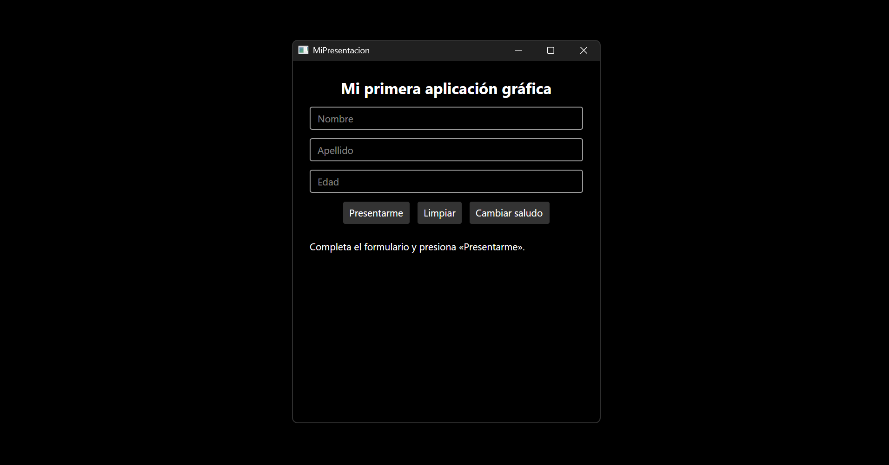
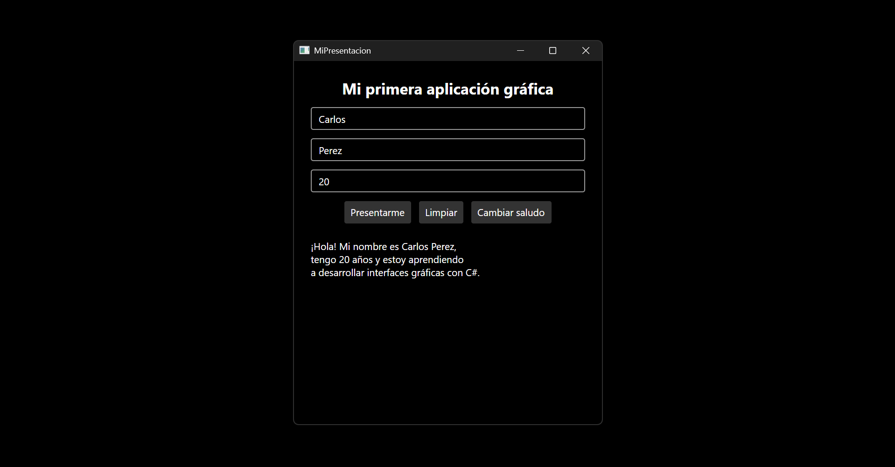
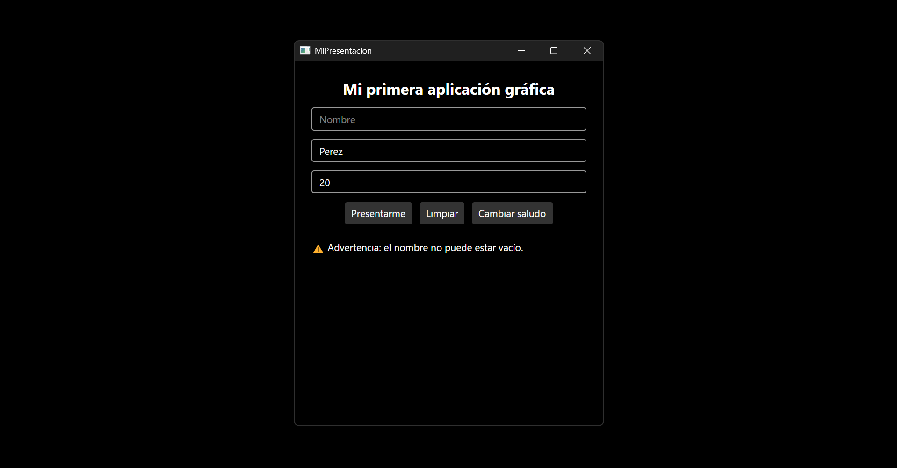

# MiPresentacion

Aplicacion de escritorio hecha con Avalonia UI 11 y C#. El usuario escribe su nombre, apellido y edad, y la aplicacion muestra una presentacion personalizada.

## Que hace

- Presentarme: valida los datos y muestra el saludo, o una advertencia si hay un error.
- Limpiar: borra los campos, restaura el mensaje inicial y pone el cursor en el nombre.
- Cambiar saludo (reto): alterna entre dos mensajes de presentacion sin cerrar la aplicacion.

## Controles usados

- TextBlock: el titulo y el resultado (TxtResultado).
- TextBox: nombre (TxtNombre), apellido (TxtApellido) y edad (TxtEdad).
- Button: BtnPresentarme, BtnLimpiar y BtnCambiarSaludo.
- StackPanel: organiza todo con Margin y Spacing.

## Como funcionan los eventos

Cada boton tiene un evento Click que ejecuta un metodo en MainWindow.axaml.cs:

- BtnPresentarme_Click: lee los tres campos, revisa que nombre y apellido no esten vacios, y que la edad sea un entero positivo con int.TryParse().
- BtnLimpiar_Click: vacia los campos y usa Focus() para volver al nombre.
- BtnCambiarSaludo_Click: cambia entre los dos mensajes y actualiza el resultado.

## Como ejecutar

Necesitas el .NET 10 SDK.

```
git clone https://github.com/juangonzalez4914-ops/MiPresentacion.git
cd MiPresentacion
dotnet run
```

## Capturas

### Formulario


### Presentacion correcta


### Mensaje de validacion


## Reflexion

MainWindow.axaml es la parte visual: ahi estan los botones, las cajas de texto y los textos de la ventana. MainWindow.axaml.cs es la parte de logica: ahi esta el codigo que dice que hacer cuando el usuario presiona un boton.

Se conectan de dos formas. Con x:Name le pongo nombre a un control en el XAML (por ejemplo TxtNombre) y asi puedo usarlo desde C# para leer lo que escribio el usuario o cambiar un texto. Con Click="NombreDelMetodo" le digo a un boton que metodo de C# debe ejecutar cuando lo presionen.

Asi funciona la aplicacion: el usuario escribe en las cajas, presiona un boton, se ejecuta el metodo, y ese metodo toma los datos con los nombres x:Name y muestra el resultado en pantalla.
